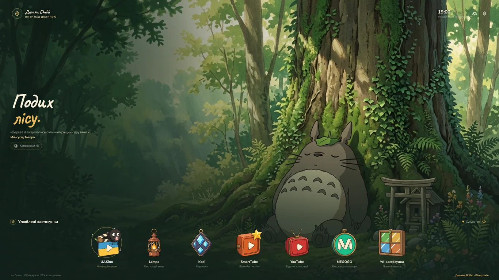
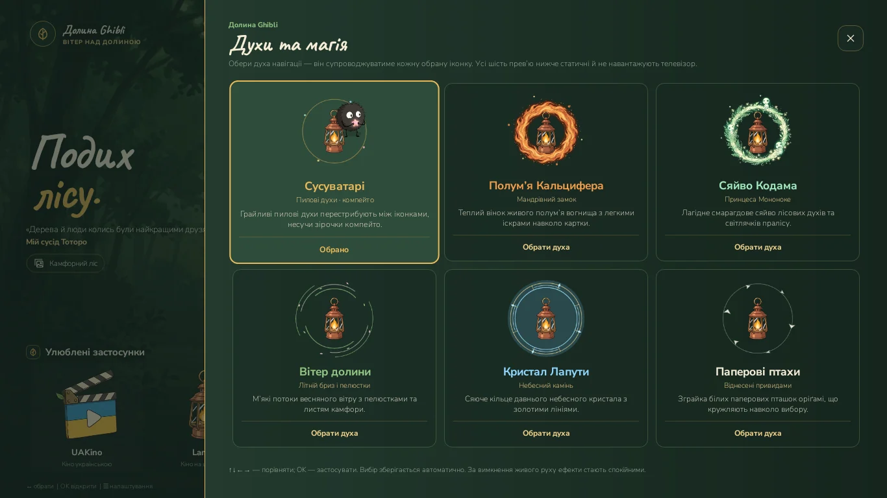
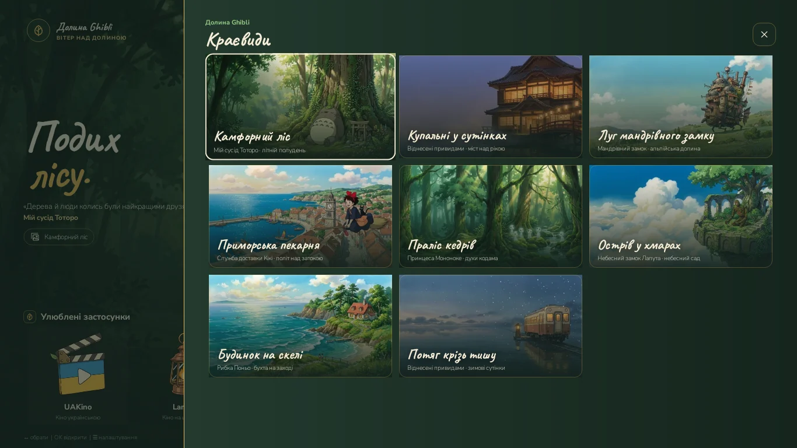
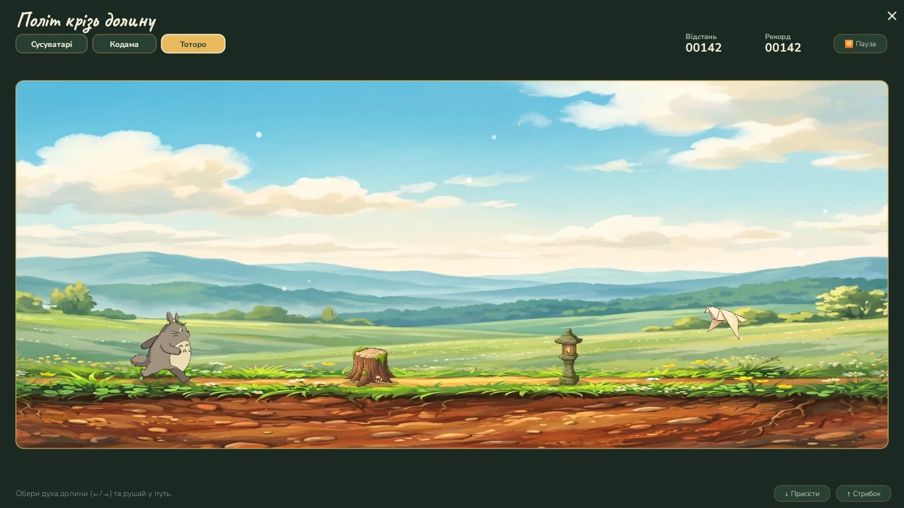

<h1 align="center">Ghibli · Вітер над долиною</h1>

<p align="center">
  <strong>Фанатський лаунчер у стилі Studio Ghibli для Android TV і Google TV</strong><br>
  Улюблені застосунки з вільними 2D cel-іконками, 8 краєвидів долини, 6 духів навігації та мінігра «Політ крізь долину».
</p>

<p align="center">
  <a href="https://github.com/oktirus/StudioGhibliLauncher/releases/download/v1.1.0/GhibliValley-1.1.0.apk"><strong>Завантажити APK 1.1.0</strong></a>
  · <a href="https://github.com/oktirus/StudioGhibliLauncher/releases/latest">Останній реліз</a>
  · <a href="#встановлення">Встановлення</a>
  · <a href="#кнопка-home">Кнопка Home</a>
</p>

## Можливості

- **Улюблені застосунки й каталог.** На головному екрані відображаються закріплені застосунки з **20 вільними 2D cel-іконками** у стилі Studio Ghibli 1990-х без квадратних рамок. У каталозі «Усі застосунки» є пошук, фільтр обраного та впорядкування.
- **Керування пультом.** Стрілки переміщують фокус, **OK** відкриває застосунок, а довге **OK** показує контекстне меню картки (закріпити, змінити порядок, про застосунок).
- **8 краєвидів і 6 духів навігації.** Камфорний ліс, Купальні у сутінках, Луг мандрівного замку, Приморська пекарня, Праліс кедрів, Острів у хмарах, Будинок на скелі та Потяг крізь тишу. Серед духів фокусу — **Сусуватарі** (стрибають між іконками з цукерками компейто), **Полум’я Кальцифера**, **Сяйво Кодама**, **Вітер долини**, **Кристал Лапути** та **Паперові птахи**.
- **Оригінальне аудіо.** Три спокійні оркестрові мелодії Joe Hisaishi (*My Neighbor Totoro*, *Spirited Away*, *Howl's Moving Castle*) і натуральні звуки навігації, духів та мінігри.
- **Режим спокою та «Політ крізь долину».** Після бездіяльності вмикається «Тиха мить» із годинником і цитатою. З верхньої панелі відкривається мінігра за **Сусуватарі**, **Кодама** або **Тоторо** з 4-кадровою целулоїдною анімацією бігу та окремими рекордами.
- **Home й оновлення.** Лаунчер можна обрати домашнім екраном Android TV. Для Google TV передбачено опційне перенаправлення **Ghibli після Home**, а нові версії перевіряються й завантажуються з GitHub прямо з налаштувань.

## Скриншоти

| Головний екран | Духи навігації |
| --- | --- |
| [](docs/media/ghibli-home.webp) | [](docs/media/ghibli-spirits.webp) |

| Галерея краєвидів | Мінігра «Політ крізь долину» |
| --- | --- |
| [](docs/media/ghibli-scenes.webp) | [](docs/media/ghibli-game.webp) |

## Встановлення

Потрібен телевізор або приставка з **Android TV чи Google TV на Android 8.0 (API 26) або новішому**.

1. Завантаж `GhibliValley-*.apk` зі сторінки [останнього релізу](https://github.com/oktirus/StudioGhibliLauncher/releases/latest).
2. Скопіюй APK на USB-накопичувач, підключи його до телевізора й відкрий файл у файловому менеджері на ТБ.
3. Якщо Android попросить дозвіл, дозволь встановлення з цього файлового менеджера й повернися до APK.
4. Натисни **Встановити → Відкрити**. У списку застосунків лаунчер має назву **Ghibli · Вітер над долиною**.

<details>
<summary>Встановлення з комп’ютера через ADB</summary>

На телевізорі має бути ввімкнене налагодження по USB або мережі. Підключи пристрій, знайди його ідентифікатор і вкажи завантажений файл.

```powershell
adb devices -l
adb -s "TV_DEVICE_ID" install -r ".\GhibliValley-1.1.0.apk"
```

Параметр `-r` оновлює сумісну версію з тим самим підписом і зберігає всі налаштування та рекорди. [Документація ADB](https://developer.android.com/tools/adb)

</details>

## Кнопка Home

1. Під час першого запуску натисни **Обрати** або відкрий **Налаштування → Домашній екран → Основний лаунчер**.
2. У системному списку вибери **Ghibli · Вітер над долиною**. Якщо є варіант **Завжди**, обери його.
3. Натисни **Back**, щоб повернутися до лаунчера. Відкрий інший застосунок і перевір **Home** на пульті.

<details>
<summary>Якщо Home відкриває штатний Google TV</summary>

1. У лаунчері відкрий **Налаштування → Домашній екран → Ghibli після Home → Відкрити налаштування**.
2. У **Спеціальних можливостях** увімкни службу **Ghibli після Home**. Повернися в лаунчер і натисни **Перевірити**.
3. З іншого застосунку натисни **Home** на пульті. Google TV може коротко з’явитися, поки служба повертає до **Ghibli · Вітер над долиною**.

Щоб повернути штатну поведінку, вимкни службу в **Спеціальних можливостях** і обери Google TV у системному меню домашнього екрана.

</details>

## Налаштування й оновлення

- **Налаштування.** Значок ліхтаря вгорі праворуч або кнопка **Menu** на пульті відкриває згруповане меню налаштувань (**Вигляд**, **Звук і музика**, **Домашній екран**, **Система**, **Про Ghibli та ресурси**). Тут можна змінити духа навігації, «Живий світ», звук, музику з автоматичним переходом між треками, ротацію краєвидів, режим спокою й опційне відображення CPU та RAM.
- **Краєвиди.** Натисни кнопку з назвою поточного краєвиду на головному екрані, щоб відкрити галерею 8 сцен.
- **Оновлення.** Відкрий **Налаштування → Про Ghibli та ресурси → Оновлення Ghibli**. Автоматична перевірка працює кожні 30 хвилин; якщо доступна новіша версія, натисни **Завантажити → Встановити** й підтвердь дію в Android. [Як працюють оновлення](docs/UPDATES.md)

## Збірка й авторство

Нативний застосунок побудований на Android Views і Custom Canvas без WebView.

```powershell
pwsh -NoProfile -File Build.ps1
```

Скрипт виконує staging у ASCII-шлях (`%LOCALAPPDATA%\GhibliLauncherBuild`), проганяє `testDebugUnitTest`, `lintDebug`, `assembleDebug`, перевіряє `aapt dump badging` і зберігає APK у `releases/`. [Повідомити про проблему](https://github.com/oktirus/StudioGhibliLauncher/issues) · [Як працюють оновлення](docs/UPDATES.md)

Розробник — **Oktirus**. Це некомерційний фанатський проєкт. Права на оригінальні твори, музику й образи Studio Ghibli належать їхнім правовласникам.
